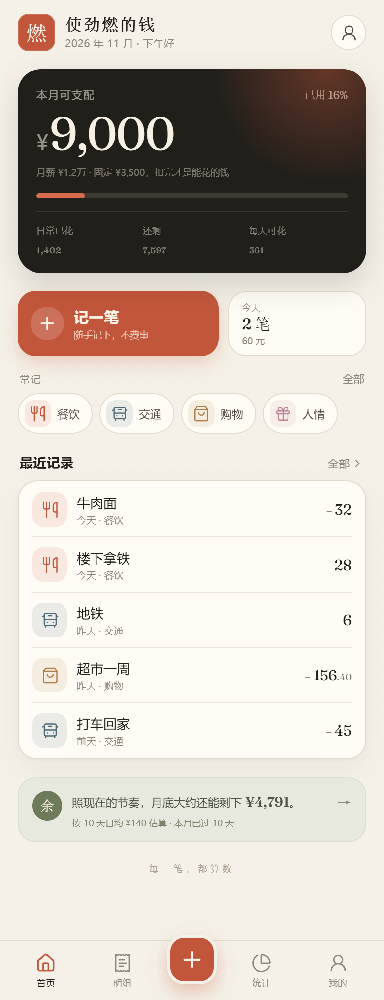
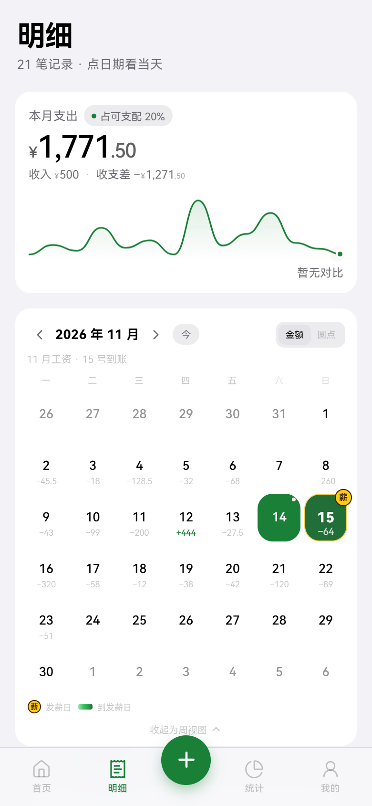
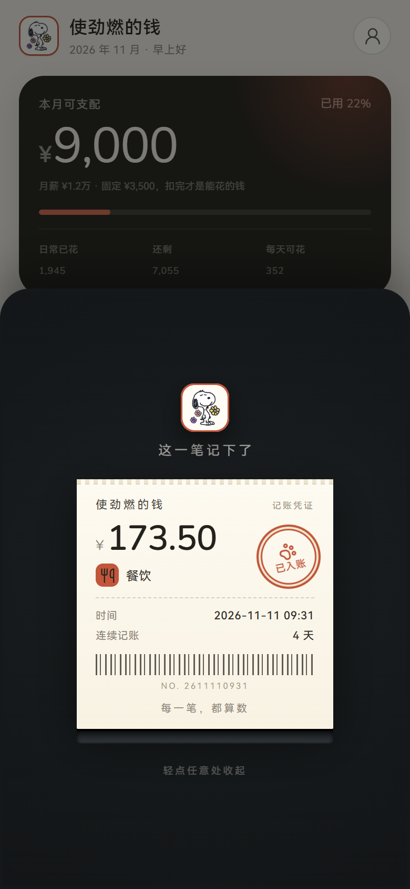

# 使劲燃的钱

> 每一笔，都算数。

一个可以直接装到 Android 手机上的本地记账 App：随手记一笔支出，按**日 / 周 / 月**看统计，先录月工资和固定支出，再算清每月**可支配的钱**和花掉的比例。

- 纯本地存储，不联网、不上传、无广告、无账号
- 深色 / 浅色 / 跟随系统 + 8 个强调色的可换主题，新装默认浅色；炭灰卡片、16px 间距、鸿蒙 Sans 中文 + Nunito 圆体数字；版式与主题系统参考 openGym，代码全部重写
- 冷启动直接渐显存钱罐海报：深青底上海报淡入、轻微拉焦，停留后虚化交给首页；不再先闪一下桌面图标
- 安装包：`release/使劲燃的钱-1.1.23.apk`（约 5.0 MB，minSdk 23 / targetSdk 35）

## 功能

| 模块 | 内容 |
| --- | --- |
| 启动 | 原生 splash 用纯色空白（不显示图标）；进入后 `LaunchScreen` 让海报从透明 + 10px 模糊渐显并拉焦，停留 1.3s 后虚化淡出，首页接手 |
| 首页 | 狗屋表头（按预算换睡觉/警惕/告急，点一下跳舞）、按手机时间问候、账本名字、本月预算三条进度、常记分类、最近流水 |
| 记一笔 | 自研 4×4 算式键盘（+ / − 实时合计）、金额分位显示、18 个内置分类（12 支出 / 6 收入）、备注、日期 |
| 明细 | 月历（每天带净额，可切金额/圆点、收起成周视图）；发薪日金色圈标记，今天到下次发薪日之间用 GitHub contribution 四级绿填充，并显示到账日；上/下月与「今」、点日期看当天流水；点任意一笔先看详情，再选修改或删除 |
| 统计 | 日 / 周 / 月三档；总支出与环比；每日柱状图；分类环形图与排行；月度预算占用 |
| 我的 | 头像（从手机相册选图，本地裁成 384×384；底部品牌角标固定用 App 默认图标，不跟头像变）、账本名字（点名字改，同步首页）、外观（深色 / 浅色 / 跟随系统、8 个强调色）、月工资、固定支出、分类管理、备份（导出成 .json 文件 / 从文件恢复）、清空、重置 |
| 引导 | 首次启动先问「每月到手多少」「每月固定支出」「几号发工资、到账的是哪个月」，可跳过，之后在「我的」里补 |
| 视觉 | 深色 `#000` / 浅色 `#f2f2f7` 两套语义色，8 个强调色（默认 iOS 绿 `#30d158`），新装默认浅色；16px 页边距与卡片间距、全宽卡片、通栏五项底栏、中间圆形主按钮 |

### 计算口径

- **固定支出（房租、房贷、订阅…）只录一次**，作为设置项从工资里预扣，不重复记进每一笔账
- **预算按自然月**：每月 1 号到月末；发薪日只决定工资哪天到账，不把月份切成两段
- **工资归属单独算**：`当月发` 或 `次月发上月`。选后者时，11 月 15 日到账的是 10 月工资，11 月整月都标「10 月工资」
- 发薪日 1–31，新装默认 **15 号 / 次月发上月**；29/30/31 遇到短月自动按当月最后一天，下个周期回到原日期
- **某个月实际到账日可单独改**：比如这个月 16 号才到账，只改当月，下个月自动回到默认日；首页会显示「本月 16 号到账 · 3 天后发薪」或「本月 16 号已到账 · 下月 15 号发薪」
- `可支配 = 本月工资 + 其他收入 − 固定支出`
- `剩余 = 可支配 − 日常支出`，百分比都以本月可支配为分母
- 收入分类（奖金/兼职/理财/红包/报销）计入「其他收入」

## 数据与备份

整本账是一个 JSON 对象（`LedgerState`：记录 + 分类 + 设置），存在手机的应用存储里，没有服务端：

- **覆盖安装不丢数据**：包名和签名不变、versionCode 递增就是升级安装，应用目录不会被清。会丢的情况只有：卸载、系统里点「清除数据」、改包名、换签名。
- **导出**：我的 → 数据备份 → 导出 → 生成 `使劲燃的钱-备份-2026-11-11.json`。安卓上会弹系统分享面板，可以存到「文件」、发微信、发网盘；浏览器里直接下载。另有「复制为文本备份」，适合贴到笔记里。
- **导入**：切到「导入」，选那个 .json 文件，也可以把内容直接粘进框里，点「导入并覆盖」后整份还原（分类和设置一起回来）。
- 换手机、重装、清数据之后，用这份文件就能把账本完整搬回去。

## 技术选型

React 18 + TypeScript + Vite 5，用 Capacitor 6 打包成原生 Android 壳，数据存 `localStorage`（键名 `shijinran.money.v1`，旧版本数据会自动迁移），图表是手写 SVG，不引入图表库。

```
src/
  types.ts              全部类型与接口（唯一一份）
  data/                 数据层：index.ts 统一出口 → store.tsx / categories.ts
  pages/                Home / Ledger / Stats / Me / Onboarding（只做布局与编排）
  sheets/               AddSheet、TxDetailSheet、Name / Budget / Payday / Category / Data 弹层
  ui/                   Money、TxRow、Charts、SparkSummary、MonthCalendar、Sheet、TabBar、Toast、Icon
  lib/                  money、date、stats、theme、backup、avatar、haptics、modal（纯函数 / 平台能力）
  styles/app.css        结构、组件与基础样式
  styles/og.css         主题皮肤：深/浅 token、8 组强调色、页面覆盖（后加载）
android/                Capacitor 生成的 Android 工程（已配好 SDK 35 / AGP 8.7.2）
design/build_icon.py    桌面图标生成脚本（源图 design/icon-src/app-icon.png）
design/build_brand.py   App 内印章生成脚本（源图 design/icon-src/mascot.png）
assets/icon/            1024px 品牌原图
docs/                   架构说明 docs/ARCHITECTURE.md、截图 docs/screenshots/
release/                可直接安装的 APK
```

结构细则见 [docs/ARCHITECTURE.md](docs/ARCHITECTURE.md)：类型只写在 `src/types.ts`；跨层只能走对方的 `index.ts`，页面只从 `../data`、`../lib`、`../ui`、`../sheets` 取东西；`npm run check` 会检查越界引用。

## 开发与打包

```bash
npm install          # 依赖（国内可用已写入的 npmmirror 源）
npm run dev          # 浏览器调试
npm run build        # 产出 dist/
npx cap copy android # 同步到原生工程
```

打包 APK（本机已备好 JDK 17 与 Gradle 8.9）：

```bash
cd android
JAVA_HOME='C:\Program Files\Java\jdk-17' /c/Android/gradle-8.9/bin/gradle.bat -p . assembleDebug
```

产物：`android/app/build/outputs/apk/debug/app-debug.apk`，`adb install -r` 即可装机。

> 当前为 debug 签名，可直接侧载安装；上架应用商店需要换成自己的 release keystore。

桌面图标和 App 里的印章是两套资产。桌面图标走 `design/build_icon.py`，源图是 `design/icon-src/app-icon.png`：从四个角洪泛抠掉白底、保留原图的圆角，再铺 5 个密度的传统图标、圆形图标、自适应前景和单色层，favicon 也一并更新。自适应前景补了一层同色模糊底再铺满 108dp，圆形或方圆遮罩裁切时不会露出白边。启动海报是 `src/assets/launch-poster.png`（存钱罐插画，代码里由 `LaunchScreen` 直接渐显）；页头小狗印章仍走 `design/build_brand.py`，源图是 `design/icon-src/mascot.png`。
换桌面图标：替换 `design/icon-src/app-icon.png` → `python design/build_icon.py` → `cap copy` 并重新打包。换启动海报：替换 `src/assets/launch-poster.png`；换页头印章：替换 `mascot.png` → `python design/build_brand.py`。图标、海报、印章三套资产互不覆盖。系统开了「主题图标」时，安卓会用自己的取色走 `ic_launcher_monochrome` 单色层，这是系统行为，不是图标本身的问题。

## 截图

| 首页 | 明细 | 记好了 |
| --- | --- | --- |
|  |  |  |

浅色主题与强调色设置见 `docs/screenshots/web/16-theme-light.png`，流水详情见 `docs/screenshots/web/17-tx-detail.png`，改账本名字见 `docs/screenshots/web/18-name.png`，发薪日与实际到账日设置见 `docs/screenshots/web/19-payday.png` 与 `20-onboarding-payday.png`；浏览器截图在 `docs/screenshots/web/`（22 张，390×844@2x，含备份弹层、发薪日设置、带发薪日的引导页与新的开屏海报）。`docs/screenshots/android/` 里保留的是 1.0 纸色版真机图；1.1 深色版打包后没有可用的模拟器（Windows 提交内存不足），原生截图未重拍。

## 设计说明

配色：深色背景 `#000000`、卡片 `#1C1C1E`、次级面 `#2C2C2E`；浅色背景 `#F2F2F7`、卡片 `#FFFFFF`。主文字与 60% 灰次要文字走同一套语义 token。强调色默认 iOS 绿 `#30D158`，另有青柠 / 天蓝 / 橙 / 紫 / 粉 / 红 / 青 / 金 8 个预设；浅色主题会自动换成同色系的深色可读版本，保证白底上的对比度。按压缩放 .97，卡片 .985。整体骨架参考 openGym 的移动端：顶部大 wordmark + 日期、16px 页边距与卡片间距、全宽圆角卡片堆叠、底部通栏五项导航（中间圆钮上凸）。只借鉴版式、间距、主题 token 和动效节奏，代码与素材全部重写；openGym 是 AGPL-3.0，不能直接拷代码。字体随包分发、不靠手机自带：中文用 **HarmonyOS Sans SC**（华为开源，字形开口大、转角微圆），数字用 **Nunito**（端头圆润、带等宽数字）。两个字体都做了子集化，只保留界面上真实出现的 700 多个字，合计 265 KB；改文案出现新字时跑 `python design/subset_fonts.py` 重新裁。卡片圆角 16px、无描边、深色下无投影 / 浅色下极浅投影，没有渐变玻璃和霓虹紫。

首页的大标题就是账本名字，可以在「我的」点名字修改，最多 20 个字，保存后立刻同步到首页、也会跟着备份一起搬走；名字留空时回落到「使劲燃的钱」。日期那一行的问候语按手机当前时间分段（早上好 / 上午好 / 中午好 / 下午好 / 晚上好 / 夜深了），每 30 秒重算一次，从后台切回前台也会刷新，不是写死的文案。

主题系统是 openGym 那套的轻量移植：`src/lib/theme.ts` 负责 `data-theme` / `data-accent`、系统偏好与本地记忆，`styles/og.css` 顶部集中放深/浅两套语义 token 和 8 组强调色；`index.html` 在首屏渲染前先读一次本地设置，避免深色闪一下。状态栏图标颜色跟随主题；主题选择随账本保存在本地，覆盖安装或导入备份都会保留。

预算按自然月重置，发薪日不改变预算月份。首页副行会写清「10 月工资 · 15 号到账 · 2 天后发薪」：11 月 15 日到账的是 10 月工资，所以 11 月整月都按 10 月工资算；12 月 1 日起切到 11 月工资，不会出现 11 月 13 日还算 9 月工资的情况。设置里可以填每月几号发工资，并选「当月发 / 次月发上月」；如果某个月实际到账日不一样，在同一个弹层里改「本月实际到账」，只影响当月，下个月自动回到默认日。统计页的「月」、明细的月历、每日柱状图和分类占比都按自然月走。发薪日填 29/30/31 时，短月自动落到月末，下个周期再回到原日期。

点流水里的任意一笔，会先弹出一张「这笔记录」卡：分类磁贴、金额（收入用苔绿、支出用墨色）、类型、备注、日期和记录时间都在里面。底部并排两个按钮：左边「修改金额」会关掉详情、打开复用的记账框，右边「删除」需要再点一次确认，避免误删；不用在列表里直接跳进编辑态。

记一笔是一块「会变形的面板」：点底部中间的加号，那个圆形按钮原地长成整块深色面板（位置、宽高、圆角同一个元素补间，内容延后淡入），收起时再缩回按钮里。面板里是计算器式键盘，`128.5+45` 这样的算式会实时折算出「= ¥173.50」，保存后按钮变成一张热敏小票（见下）。整块面板始终是深色计算器（像 iOS 计算器一样不跟页面主题走）：炭黑 `#15181A` + 当前强调色，默认是 iOS 绿 `#30D158`。

数字会「跳」：每敲一键，金额整体上跳 2.5px、放大到 1.045 倍再落回（210ms，Web Animations，连打会重跑而不是叠加）；换分类时分类磁贴轻微弹一下，出现算式时「= ¥总计」从下方滑入。系统开了减少动态效果时，这些都会自动关掉。

保存之后不是直接收起，而是把面板当成一台小机器，出一张热敏小票：金币从上方旋着落进出票口（580ms，3D 翻转带一点回弹，落槽时槽口被压一下），小票从槽里升上来（820ms，用 `clip-path` 从下往上揭，读起来就是纸在往外走），小票上印着金额、分类、备注、时间、连续记账天数和一段条形码，1150ms 时一枚朱砂红的双圈硬币章从右上角砸下来（中间一个 ¥，下面「已入账」，放大 2.3 倍落回 1 倍，带一点过冲），停一会儿后整块淡出并收起面板，全程 2.6 秒。轻点任意处可以立刻收起。小票仍是奶油纸配炭黑面板，红章和 App 的朱砂品牌色一致。编辑已有记录时印章换成「已更新」，标题换成「修改凭证」。

品牌标记是那只抱花的小狗：页头、我的页、引导页都用同一枚印章——深色圆角卡片里放贴纸，外面一圈 1.5px 朱砂细线（线画在图形之上，不会被盖住）。小图用的是 `src/assets/mascot.png`（由 `design/build_brand.py` 从 `design/icon-src/mascot.png` 生成：方块画布 + 整张贴纸居中），和桌面图标是两套资产，印章里始终是那只完整的小狗，不裁头也不切花。小票顶部的头像跟「我的」保持一致：设置过个人头像时用头像，没设置时回退成这枚小狗印章。

「数据备份」弹层分导出、导入两个模式：导出页是一张文件名卡片（`使劲燃的钱-备份-日期.json` + 记录数 / 分类数 / 文件大小）加一个「导出备份文件」按钮，安卓走 `Filesystem` 写缓存再 `Share` 唤起系统分享面板，浏览器退化成 Blob 下载；导入页是「选择备份文件」+ 可编辑的文本框，两条路都行，读进来的内容先过一遍 `normalize()` 再整份覆盖。两个模式共用同一块弹层，切页不重开。

明细页顶部是一条趋势横条，替掉原来的「支出 / 收入 / 收支差」三栏：左边是本月支出、占可支配的比例、收入与收支差，右边一条 42px 高的迷你曲线画这个月每天的支出。进页面时按路径长度做描边生长（1.15s，Web Animations，先量 `getTotalLength()` 再跑关键帧，避免首帧反向闪一下），面积渐变晚 80ms 淡入，末点有一个呼吸光斑，卡片上还有一层 5.6s 一轮的扫光。空月份曲线会转成灰色细线、不显示光斑。

再往下是账本日历：周一开始的 7 列格子，每格日期下面写当天的净额（收入 − 支出），支出为负、收入为正，正数用绿；右上角一个小红点标今天。右上角可以在「金额 / 圆点」之间切，圆点模式只留一个 4px 的点，适合记完账快速扫一眼。点任意日期，下面就是那一天的流水；跨月补位的日期也能点，会自动翻到对应月份。底部「收起为周视图」只展开选中日所在的那一周，再点一次展开整月。趋势横条和日历都不重复三栏概览：本月支出、收入、收支差已经在横条里了。


## 参考的开源项目

调研后没有直接套壳，而是取了各家信息架构和交互里最成熟的部分，重写成一套自己的视觉：

- [glink25/Cent](https://github.com/glink25/Cent)：账本 / 分类 / 交易 / 统计四段式信息架构
- [mayswind/ezbookkeeping](https://github.com/mayswind/ezbookkeeping)：多币种与统计口径的参考
- [LouBii/OneAccount](https://github.com/LouBii/OneAccount)：极简记账的数据结构
- [378056350/react-native-bookkeeping](https://github.com/378056350/react-native-bookkeeping)：鲨鱼记账式数字键盘与九宫格分类
- [forkdog/Bookkeeping](https://github.com/forkdog/Bookkeeping)：移动端记账的页面流
- [DuarteSantos8/openGym](https://github.com/DuarteSantos8/openGym)：深色卡片、16px 间距、周条卡与通栏底栏的版式参考（AGPL-3.0，仅借鉴视觉，未复制代码或素材）

交互细节同时参考了 B 站记账类测评里被反复提到的点：一页账、卡片式、少层级、无广告、数字优先。
