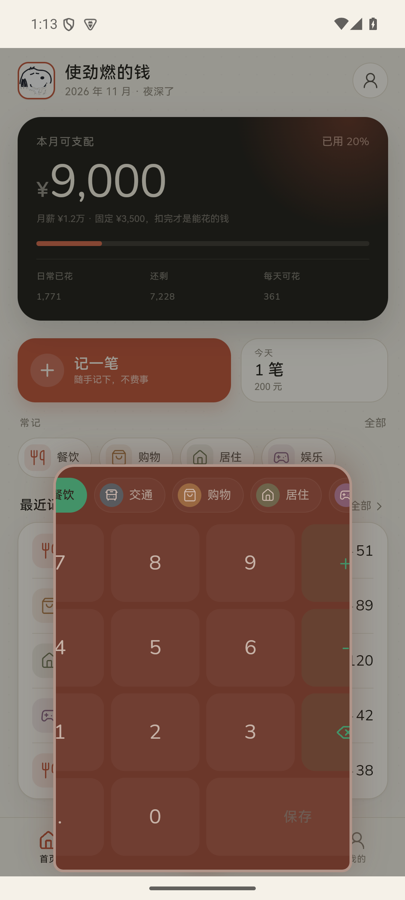
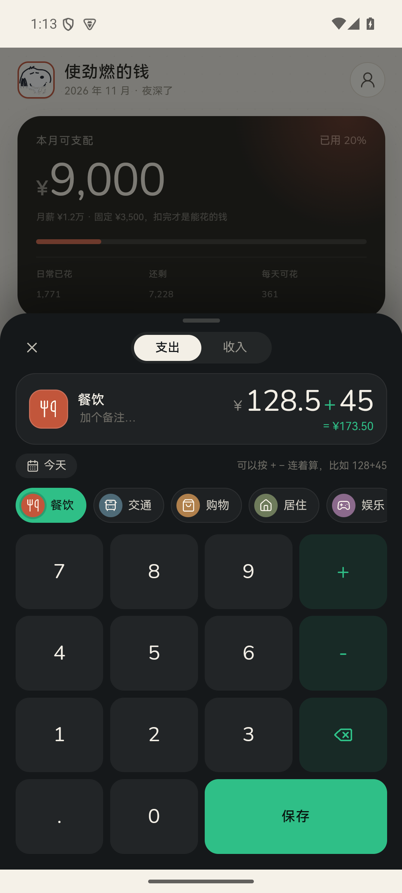
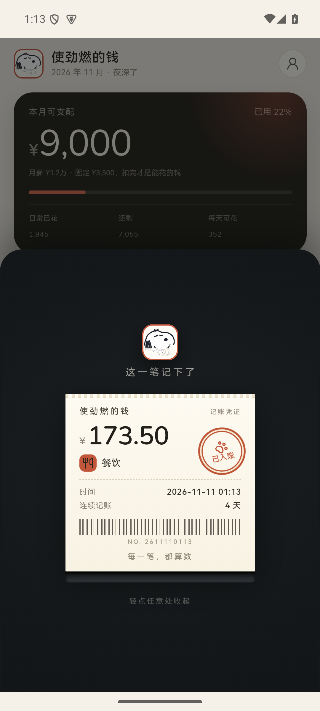

# 使劲燃的钱

> 每一笔，都算数。

一个可以直接装到 Android 手机上的本地记账 App：随手记一笔支出，按**日 / 周 / 月**看统计，先录月工资和固定支出，再算清每月**可支配的钱**和花掉的比例。

- 纯本地存储，不联网、不上传、无广告、无账号
- 暖纸 / 墨色 / 朱砂配色，鸿蒙 Sans 中文 + Nunito 圆体数字，不套通用 UI 模板
- 安装包：`release/使劲燃的钱-1.0.0.apk`（约 4.4 MB，minSdk 23 / targetSdk 35，arm 全架构）

## 功能

| 模块 | 内容 |
| --- | --- |
| 首页 | 本月可支配金额、已用百分比、剩余、每天还能花多少；常记分类（按使用频率排序）；最近记录 |
| 记一笔 | 自研 4×3 数字键盘、金额分位显示、18 个内置分类（12 支出 / 6 收入）、备注、日期、键盘可盲打 |
| 明细 | 按月切换、全部/支出/收入筛选、按天分组小计、点开可改可删 |
| 统计 | 日 / 周 / 月三档；总支出与环比；每日柱状图；分类环形图与排行；月度预算占用 |
| 我的 | 月工资、固定支出、分类管理、数据导出/导入/清空、重置 |
| 引导 | 首次启动先问「每月到手多少」「每月固定支出」，可跳过，之后在「我的」里补 |

### 计算口径

- **固定支出（房租、房贷、订阅…）只录一次**，作为设置项从工资里预扣，不重复记进每一笔账
- `可支配 = 月工资 + 其他收入 − 固定支出`
- `剩余 = 可支配 − 日常支出`，百分比都以可支配为分母
- 收入分类（奖金/兼职/理财/红包/报销）计入「其他收入」

## 技术选型

React 18 + TypeScript + Vite 5，用 Capacitor 6 打包成原生 Android 壳，数据存 `localStorage`（键名 `shijinran.money.v1`，旧版本数据会自动迁移），图表是手写 SVG，不引入图表库。

```
src/
  types.ts              全部类型与接口（唯一一份）
  data/                 数据层：index.ts 统一出口 → store.tsx / categories.ts
  pages/                Home / Ledger / Stats / Me / AddSheet / Onboarding
  components/           Money、TxRow、Charts、SparkSummary（趋势横条）、SuccessReceipt（记账成功小票）、MorphSheet、Sheet、TabBar、Toast、Icon
  utils/                money、date、stats、haptics、modalStack（index.ts 统一出口）
  styles/app.css        单一样式表，文件头有分区目录
android/                Capacitor 生成的 Android 工程（已配好 SDK 35 / AGP 8.7.2）
design/build_brand.py   图标 / 启动图 / favicon 生成脚本（源图在 design/icon-src/mascot.png）
assets/icon/            1024px 品牌原图
docs/                   架构说明 docs/ARCHITECTURE.md、截图 docs/screenshots/
release/                可直接安装的 APK
```

结构细则见 [docs/ARCHITECTURE.md](docs/ARCHITECTURE.md)：类型只写在 `src/types.ts`，页面只从 `../data`、`../components`、`../utils` 三个入口取东西。

## 开发与打包

```bash
npm install          # 依赖（国内可用已写入的 npmmirror 源）
npm run dev          # 浏览器调试
npm run build        # 产出 dist/
npx cap copy android # 同步到原生工程
```

打包 APK（本机已备好 JDK 17 与 Gradle 8.9）：

```bash
cd android
JAVA_HOME='C:\Program Files\Java\jdk-17' /c/Android/gradle-8.9/bin/gradle.bat -p . assembleDebug
```

产物：`android/app/build/outputs/apk/debug/app-debug.apk`，`adb install -r` 即可装机。

> 当前为 debug 签名，可直接侧载安装；上架应用商店需要换成自己的 release keystore。

图标源图是一张贴纸，脚本会先洪泛抠掉白底再排版；系统开了「主题图标」时，安卓会用自己的取色替换底色、走脚本生成的 `ic_launcher_monochrome` 单色层，这是系统行为，不是图标本身的问题。
改 App 名字或配色时：改 `design/build_brand.py` 顶部的常量 → `python design/build_brand.py` → 重新 `cap copy` 并打包，图标、各密度启动图、favicon 会一起更新。
换图标就替换 `design/icon-src/mascot.png`（带白底的手绘贴纸也行，脚本会自己抠白底）：先洪泛抠图 → 缩进纸色圆角卡片 → 铺 5 个密度的自适应图标、圆形图标、单色主题图标，再生成 11 张启动图和 favicon。

## 截图

| 记一笔 | 记一笔（算式） | 记好了 |
| --- | --- | --- |
|  |  |  |

真机全套截图在 `docs/screenshots/android/`（14 张，含形变中间帧），浏览器版在 `docs/screenshots/web/`（13 张）。

## 设计说明

配色：纸 `#F5F1E8`、卡片 `#FFFCF5`、墨 `#211F1A`、朱砂 `#C2563B`、苔绿 `#6E7B5B`。字体随包分发、不靠手机自带：中文用 **HarmonyOS Sans SC**（华为开源，字形开口大、转角微圆），数字用 **Nunito**（端头圆润、带等宽数字）。两个字体都做了子集化，只保留界面上真实出现的 700 多个字，合计 265 KB；改文案出现新字时跑 `python design/subset_fonts.py` 重新裁。圆角 18–20px、1px 描边、极浅投影，没有渐变玻璃和霓虹紫。

记一笔是一块「会变形的面板」：点底部中间的加号，那个圆形按钮原地长成整块深色面板（位置、宽高、圆角同一个元素补间，内容延后淡入），收起时再缩回按钮里。面板里是计算器式键盘，`128.5+45` 这样的算式会实时折算出「= ¥173.50」，保存后按钮变成一张热敏小票（见下）。整块面板的配色是纸面上的深色对比面：炭黑 `#15181A` + 薄荷绿 `#2FBF87`，与正文的朱砂不冲突。

数字会「跳」：每敲一键，金额整体上跳 2.5px、放大到 1.045 倍再落回（210ms，Web Animations，连打会重跑而不是叠加）；换分类时分类磁贴轻微弹一下，出现算式时「= ¥总计」从下方滑入。系统开了减少动态效果时，这些都会自动关掉。

保存之后不是直接收起，而是把面板当成一台小机器，出一张热敏小票：金币从上方旋着落进出票口（580ms，3D 翻转带一点回弹，落槽时槽口被压一下），小票从槽里升上来（820ms，用 `clip-path` 从下往上揭，读起来就是纸在往外走），小票上印着金额、分类、备注、时间、连续记账天数和一段条形码，1150ms 时一枚「爪印 + 已入账」的双圈朱红章从右上角砸下来（放大 2.3 倍落回 1 倍，带一点过冲），停一会儿后整块淡出并收起面板，全程 2.6 秒。轻点任意处可以立刻收起。小票是奶油纸配炭黑面板，颜色还是纸/墨/朱砂那套，没有另起一套视觉。编辑已有记录时印章换成「已更新」，标题换成「修改凭证」。

品牌标记是那只抱花的小狗：页头、我的页、引导页和小票顶部都用同一枚印章——纸色圆角卡片里放裁好的头部贴纸，外面一圈 1.5px 朱砂细线（线画在图形之上，不会被盖住）。小图用的是 `src/assets/mascot-head.png`（由 `design/build_brand.py` 从整张贴纸里裁出头、擦掉花与项圈、留 320px），27px 的页脚尺寸也还认得出是谁。

明细页顶部是一条趋势横条，替掉原来的「支出 / 收入 / 收支差」三栏：左边是本月支出、占可支配的比例、收入与收支差，右边一条 42px 高的迷你曲线画这个月每天的支出。进页面时按路径长度做描边生长（1.15s，Web Animations，先量 `getTotalLength()` 再跑关键帧，避免首帧反向闪一下），面积渐变晚 80ms 淡入，末点有一个呼吸光斑，卡片上还有一层 5.6s 一轮的扫光。空月份曲线会转成灰色细线、不显示光斑。


## 参考的开源项目

调研后没有直接套壳，而是取了各家信息架构和交互里最成熟的部分，重写成一套自己的视觉：

- [glink25/Cent](https://github.com/glink25/Cent)：账本 / 分类 / 交易 / 统计四段式信息架构
- [mayswind/ezbookkeeping](https://github.com/mayswind/ezbookkeeping)：多币种与统计口径的参考
- [LouBii/OneAccount](https://github.com/LouBii/OneAccount)：极简记账的数据结构
- [378056350/react-native-bookkeeping](https://github.com/378056350/react-native-bookkeeping)：鲨鱼记账式数字键盘与九宫格分类
- [forkdog/Bookkeeping](https://github.com/forkdog/Bookkeeping)：移动端记账的页面流

交互细节同时参考了 B 站记账类测评里被反复提到的点：一页账、卡片式、少层级、无广告、数字优先。
